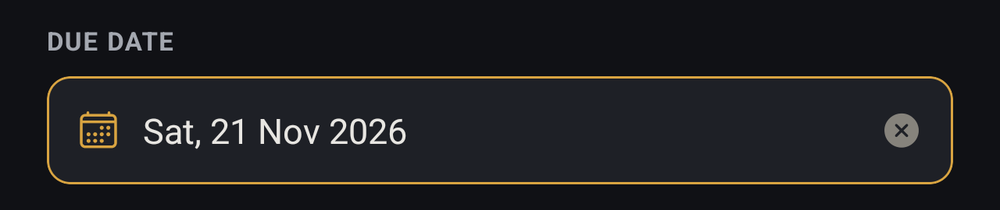
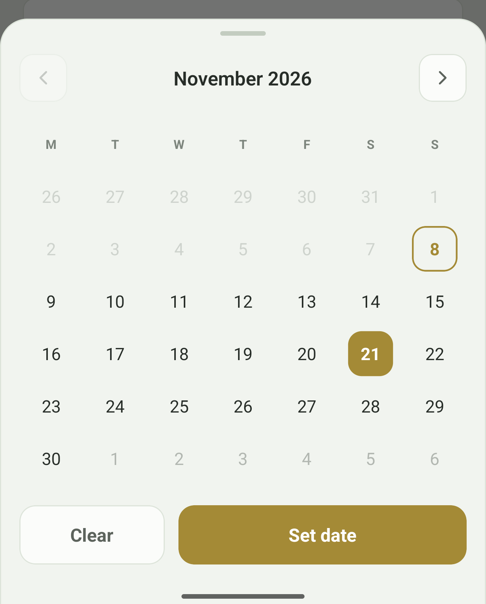

# Dates and the calendar

Tasks and groups can carry a **due date** — the day the work is meant to be
finished by. It is always optional. Plenty of tasks never get one, and nothing
in Zakhira requires it.

You pick a date from a calendar. There is nothing to type and no format to
remember.

## Setting a due date

The **Due Date** field appears on the New Task and New Group forms. Tap it and
a calendar rises from the bottom of the screen.

Tap a day to choose it, then **Set date**. Until you press that, nothing is
decided — you can tap around the month freely, and dismissing the calendar by
tapping outside it leaves the field exactly as you found it.

**Clear** removes the date entirely and closes the calendar. A task with no due
date is perfectly normal; it simply never appears as due or overdue.

Once set, the field reads the date back in full, so there is no chance of
misreading an ambiguous number:

The small **×** clears the date without reopening the calendar.

## Reading the calendar

The week starts on **Monday**. Each month fills a fixed six-row block, so the
buttons never shift position as you move between a short February and a long
November.

- **Today** is ringed in the accent colour but not filled — it is a landmark,
  not a selection.
- **The chosen day** is filled solid.
- **Dimmed days at the top and bottom** belong to the previous and next months.
  They are real days: tapping one selects it and carries the calendar to that
  month. They are there so the first and last weeks are whole, rather than
  trailing off into blank squares.
- **Faded days you cannot tap** are in the past. See below.

## Moving between months

The arrows either side of the month name step back and forward one month.

When you are looking at any month other than the current one, a **Today**
button appears beside the month name:

It returns the calendar to the current month. It does **not** choose today's
date — it only brings you back, leaving the choice to you. On the current month
the button is absent, because there would be nowhere for it to go.

## Why some days cannot be chosen

**A due date cannot be in the past.** Days before today are faded and do not
respond, and the back arrow stops at the current month rather than paging into
one with nothing selectable in it.

A deadline that has already passed is almost never what someone means to set,
and a mistyped one used to be easy to make and hard to spot. If you need to
record that something *was* due earlier, put it in the task's notes or a
comment rather than the due date.

This applies to the calendar only. Dates already saved before this rule existed
are left alone and still display normally.

## Overdue tasks

A task whose due date has passed is **overdue**. On the dashboard its date
turns red and the task is counted in the Overdue tile. Completed and scrapped
tasks are never counted as overdue, however old their date — the work is
finished, so the deadline has stopped mattering.

## Both themes

The calendar follows the app's theme like everything else. Light reads the same
way: today ringed, the chosen day filled, past days faded out.

Switch themes under **Settings → Appearance**.
