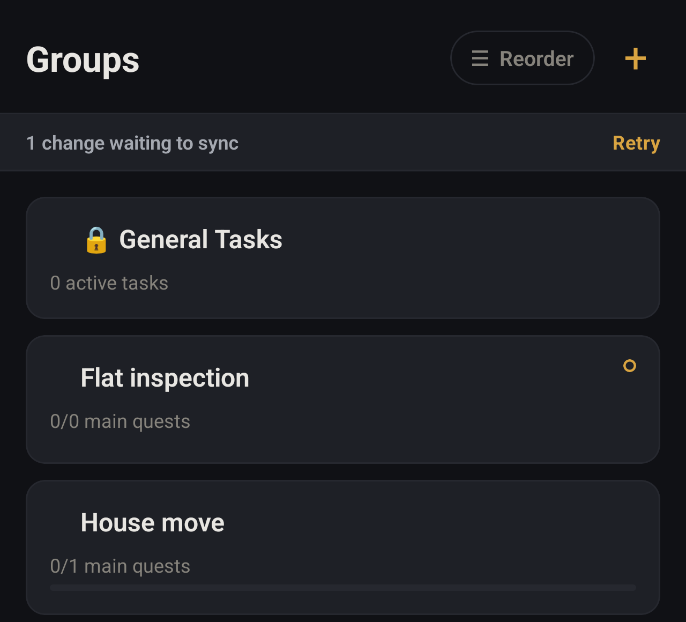
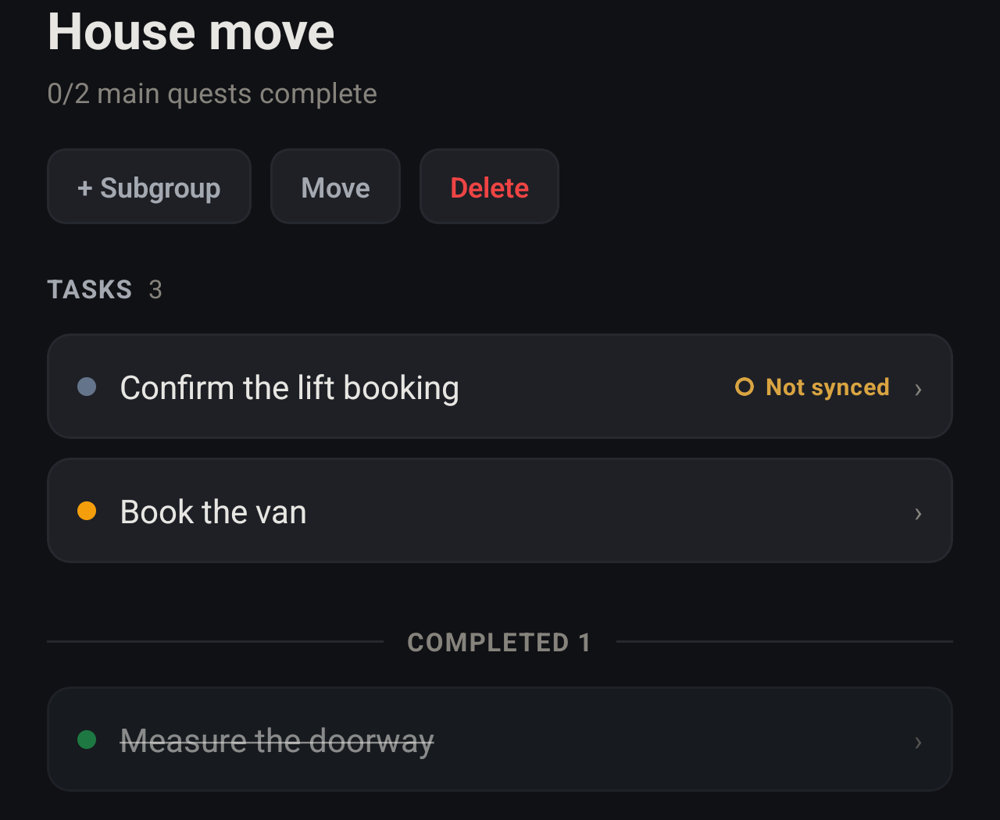

# Working offline

The phone keeps its own copy of everything. Open the app on a train, in a
basement or with the signal off and your groups and tasks are there, exactly as
you last saw them. You can read them, and you can add to them.

Nothing about this is a mode you switch on. The app always works this way; the
connection only decides how quickly your changes reach the other device.

## What you see when you open the app

Your tasks, immediately. The phone does not wait for the server before drawing
the screen — it shows what it already has, then quietly catches up in the
background.

The only time you see a loading spinner is the very first launch after signing
in, when there is genuinely nothing saved yet.

## Changes you make without a connection

Create a task, create a group, change a task's status, start or stop a timer —
all of it works. The change appears straight away and is kept on the phone until
it can be sent.

Anything still waiting carries a small hollow ring, and a line at the top of the
screen counts what is outstanding.

*A group created without a connection. The ring marks it as not yet sent, and
the line above counts everything still waiting.*

Inside a group, tasks in the same position say so in words.

*The task is real, it belongs to the group, and it is yours to work with. The
label only says the server has not been told yet.*

When the connection comes back, everything goes out on its own — usually within
half a minute, or immediately if you pull down to refresh. The rings disappear
as each change lands. There is no button to press and nothing to remember.

## When the same task changed in two places

If you edit a task on your phone while offline and the same task changes on the
desktop before your phone reconnects, the two have to be reconciled.

**The more recent change wins.** Whichever edit was made later is the one that
survives, and the older one is discarded. The app does not ask you to choose,
and it does not keep both.

In practice this is almost always what you want: the later edit is the one made
with more knowledge. It is worth knowing it is the rule, though, because a
change you made hours ago on a phone in your pocket can be quietly replaced by
one you made on the desktop since.

A task you *created* offline is never affected. It is new, nothing else can have
changed it, and it arrives intact however long it waited.

## The parts that still need a connection

Three things cannot be done offline, and say so rather than failing quietly:

- **Deleting a group.** Deleting rearranges everything inside it — tasks move,
  sub-groups are promoted — and the result has to be worked out in one place
  for every device.
- **Reordering your groups.** The order is numbered across all your devices at
  once, so it cannot be decided by a phone on its own.
- **Comments.** A task's comment log is fetched when you open the task and is
  not stored on the phone, so there is nothing to add to while offline.

Everything else — the work of actually using the app — carries on.

## Signing out discards what has not been sent

Signing out clears the saved copy, and that includes any changes still waiting
to go. If there are any, the confirmation says how many before you commit to it.

If you have been working offline, reconnect and let the count reach zero before
signing out.

## What is stored, and where

The saved copy lives in the app's private storage on the phone, and goes away
when you sign out or uninstall. **Settings** shows what is there: when the phone
last synced, how many groups and tasks it is holding, and whether anything is
waiting. There is a **Sync now** there too, for when you would rather not wait.

The desktop keeps a copy as well, so it also opens with your data already on
screen. It cannot queue changes, though — on the desktop, edits need a
connection.
